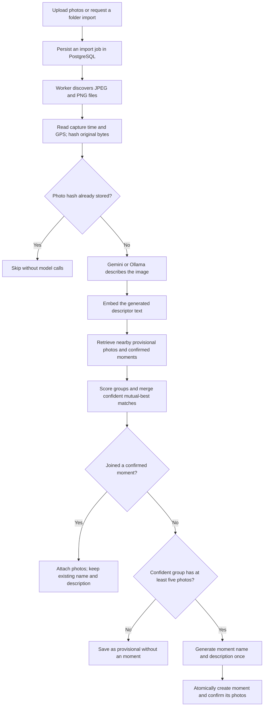
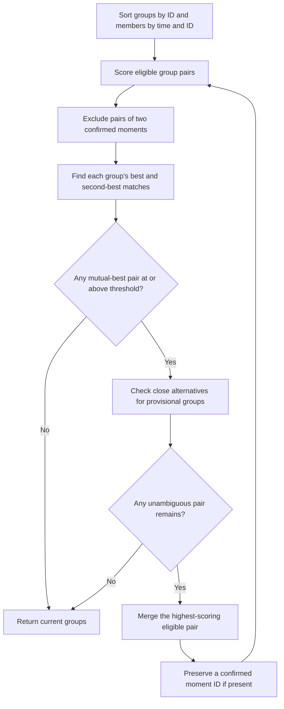

# Photo moments Clustering

## Current Worker Implementation

The sections below describe the target event-clustering design. The implemented
gallery worker uses the same default event scoring, mutual-best merging,
ambiguity checks, five-photo promotion, and immutable confirmed-moment anchors,
with these integration details:

- Upload handlers perform no Gemini calls. Existing asynchronous preprocessing
    creates the thumbnail/EXIF records and atomically inserts a
    `moment_description_jobs` row for each eligible image.
- Run `go run ./cmd/moments-worker` separately, or use the Compose
    `moments-worker` service. It polls the durable queue every five seconds when
    idle and drains ready jobs immediately when busy.
- After schema migration, each enabled worker startup discovers eligible existing
    images across all owners whose description or current descriptor-text vector
    is missing, invalid, or outdated. Only completed preprocessing is eligible;
    deleted photos, videos, moment opt-outs, and secondary near duplicates are
    excluded. There is no age cutoff, and confirmed-moment members are included
    without changing their membership or summary. Conflict-safe insertion keeps
    pending jobs and leases intact; fully cached photos are not requeued. The
    durable backlog drains under the same daily image limit, automatically
    continuing on the next UTC day without a weekly schedule or manual request.
- `ENV_AI_FEATURE=YES` and a configured
    `ENV_MOMENTS_GEMINI_API_KEY` enable processing. Set `ENV_AI_FEATURE=NO` in
    the server and worker environments and recreate the services to disable
    Gemini; queued photos remain pending. A worker already processing a request
    cannot undo that external call.
- `ENV_MOMENTS_DAILY_IMAGE_LIMIT=100` caps new image-description attempts across
    workers per UTC calendar day. Zero pauses the worker. Reservations are atomic
    and retained in `moment_daily_usage`; failed or interrupted attempts consume
    their reservation. Retries with cached descriptions use no new image quota.
    Moment naming and user-requested metadata suggestions are separate text calls,
    not part of this image limit.
- Each job has a unique lease token and a 15-minute lease. Work times out after
    ten minutes. Errors retain the job with increasing retry delay (up to an hour);
    expired leases are reclaimable after crashes. Successful description and event
    evaluation delete only the job row. Descriptions, keywords, descriptor-text
    vectors, and embedding model identities remain permanently cached in
    `media_image_descriptions`, including photos still provisional. Active leases
    serialize work per owner to prevent competing naming/assignment decisions;
    different owners can be processed concurrently.
- Candidate retrieval is owner-scoped and loads up to 50 neighboring groups plus
    the seed group. It combines reliable-time/GPS candidates with positive-cosine
    descriptor-text candidates using compatible model identities and dimensions,
    retains each group's best rank, then loads cached members and uncached
    confirmed-moment metadata anchors of each group. It has no seven-day
    cutoff. Existing confirmed memberships remain unchanged; additions update time
    bounds and counts without changing title, description, or user-edit state.
- After caching the vision description, the enabled worker embeds the generated
    description, keywords, objects, and activities with Gemini `embedContent`.
    `ENV_MOMENTS_GEMINI_EMBEDDING_MODEL` defaults to `gemini-embedding-001` with
    `SEMANTIC_SIMILARITY` and 768 dimensions; task and dimension are part of the
    cached model identity. Matching uses cosine for compatible vectors and token
    Jaccard for legacy/missing/incompatible vectors. CLIP pixel vectors are never
    used for descriptor similarity. No `pgvector` extension is required; PostgreSQL
    computes exact cosine over stored arrays. Ollama support is not implemented.
- Embedding failures retain the job and cached description; retries do not repeat
    vision inference. Existing valid vectors are reused. Changing embedding models
    re-embeds descriptions as their queued jobs run, not by scheduled whole-library
    reclustering. Embedding and naming requests are separate text calls outside the
    image-description attempt quota.
- Unassigned media represents provisional state; this schema uses `moment_media`
    membership rather than `moment_id` and `clustering_status` columns on photos.
    EXIF metadata capture times provide reliable timing; upload timestamps only
    provide ordering. Existing SHA-256 and near-duplicate handling exclude repeated
    files before moment processing.
- Event constants currently use the defaults documented below; the target CLI
    flags and alternative policies in the later configuration table are not wired
    into this worker. The weekly moment scheduler and its interval setting have
    been removed. The OpenCV executable is not part of automatic moment generation.
- `POST /moments/generate` queues existing eligible images for the current owner
    and returns `{"created":0,"queued":N}`. Metadata suggestions never generate
    missing image descriptions outside the worker.

Current implementation: [worker](../cmd/moments-worker/main.go),
[job lifecycle](../app/moments/jobs.go), [event scoring](../app/moments/event.go),
[queue and quota](../app/db/moment_jobs.go), and
[event persistence](../app/db/moment_events.go).

Run the current checks with `go test ./app/moments ./app/db ./cmd/moments-worker`.
Set `TEST_DATABASE_URL` only to an isolated test PostgreSQL instance to include
`go test ./app/db -run TestPostgresMoment -count=1`. These tests retain unique
schemas for inspection. No Gemini credentials or live model requests are needed.

## Purpose

The default `event` policy groups photos that plausibly belong to the same real-world event. It combines the meaning of image descriptions with capture-time and GPS evidence. Similar-looking photos alone are not sufficient: two beach holidays taken weeks apart should not automatically become one moment.

The main rules are:

- Keep uncertain photos provisional instead of forcing an assignment.
- Create an moment only when a confident event group contains at least five distinct photos by default.
- Generate the moment name and description once, when the moment is created.
- Add later matching photos without regenerating the moment name or description.
- Never automatically merge two confirmed moments, split an existing moment, or move its confirmed photos elsewhere.

This is a deterministic, rule-based agglomerative algorithm over a retrieved neighborhood. It is not K-means, DBSCAN, face recognition, or an LLM deciding which moment each photo belongs to. Gemini or Ollama supplies image descriptions and embeddings; Go code makes clustering decisions.

## End-To-End Flow



Uploads return an asynchronous job rather than waiting for inference. A multipart upload can contain multiple files, but the importer processes photos individually. A batch of five files does not automatically produce an moment: those photos must be distinct and satisfy the same event rules.

## Photo Features

| Feature | Source | Use |
| --- | --- | --- |
| Photo ID | SHA-256 of original file bytes | Duplicate detection and stable identity |
| Capture timestamp | JPEG EXIF, with configured timezone where needed | Reliable event timing only when `date_source='exif'` |
| Fallback timestamp | File modification time | Retained for ordering, but not accepted as reliable event-time evidence |
| GPS coordinates | Available EXIF latitude and longitude | Geographic evidence and candidate retrieval |
| Description, keywords, objects, activities | Selected vision provider | Descriptor similarity and text embedding input |
| Embedding and model identity | Selected embedding provider | Semantic comparison only between compatible vectors |

Original photo bytes and available metadata are retained. The inference image is orientation-corrected, resized to at most 1280 pixels on its longest edge, and JPEG-encoded without EXIF metadata. The metadata is handled separately by the application.

Embeddings represent the **generated text**, not the original pixels. Their quality depends on what the image description captures. The system does not compare faces or infer identities.

An identical file is skipped before description and embedding. Assignment checks for duplicates again inside its database transaction, protecting against concurrent imports. Duplicate files do not count toward the five-photo minimum. Visually identical files with different bytes can have different IDs; this is not perceptual deduplication.

## Candidate Retrieval

Clustering does not scan and regroup the entire library on each upload. The store retrieves a bounded set of candidate groups for the incoming photo.

1. **Metadata candidates:** find groups containing photos within the configured capture-time window when both timestamps are EXIF-derived, or with GPS latitude sufficiently near the incoming photo. Latitude is a coarse retrieval filter, not the final distance test.
2. **Semantic candidates:** find groups containing positive-cosine-similarity embeddings with the same model identity and vector dimension.
3. Rank metadata candidates by nearest reliable time gap, then recency and ID. Rank semantic candidates by their best member similarity, then ID.
4. Combine the two ranked lists and retain group IDs ordered by their best rank, then ID, up to `EVENT_CANDIDATES` (default 50).
5. Load every photo in each selected group and add the incoming photo as a new singleton group.

A confirmed moment is retrieved as one group. An unassigned provisional photo is initially retrieved as its own group; provisional groups below the moment minimum are rebuilt during later neighborhood evaluations rather than persisted as separate cluster objects.

The cap applies to retrieved group IDs, not the total number of loaded photos. The incoming singleton can make the initial clustering input contain 51 groups with default settings. A large confirmed moment can contribute many members.

Semantic retrieval improves recall, but does not bypass time, GPS, or ambiguity checks. A semantically similar photo from another trip can enter the neighborhood and still be rejected.

## Group Scoring

The algorithm compares two groups, not only the incoming photo against a single moment representative. Each comparison first applies eligibility rules and then computes a normalized score.

### Eligibility Rules

| Check | Default | Effect |
| --- | --- | --- |
| Combined reliable capture-time span | At most 48 hours | Reject if earliest-to-latest EXIF timestamps across both groups exceed the window |
| Nearest cross-group capture-time gap | At most 12 hours | Reject if reliable timestamps exist on both sides and even their nearest pair is farther apart |
| Nearest cross-group GPS distance | At most 50 km | Reject if both sides have valid GPS and even their nearest pair is farther apart |
| Group descriptor similarity | At least 0.2 | Reject semantically unrelated groups even when time or location matches |
| Corroboration | Time or GPS score at least 0.5 | Reject if neither positively weighted metadata signal provides strong enough support |

Missing timestamps or GPS do not fail their respective distance checks by themselves. However, at least one usable, positively weighted metadata signal must corroborate the event. When both time and GPS are available, a hard rejection in either cannot be rescued by the other signal.

The time-span check uses all reliable timestamps. Nearest time and GPS distances use all cross-group member pairs. These are nearest-pair geographic constraints, not a guarantee that every pair of photos inside a resulting moment is within 50 km.

### Descriptor Similarity

For each sampled cross-group photo pair:

1. Use cosine similarity when embeddings have equal dimensions, finite values, nonzero norms, and matching nonempty model identities.
2. Otherwise use token Jaccard similarity over the combined description, keywords, objects, and activities.
3. Clamp negative cosine similarity to zero for scoring.

Cosine similarity is:

$$
\operatorname{cosine}(x,y)=\frac{x\cdot y}{\lVert x\rVert\lVert y\rVert}
$$

The fallback lowercases text, splits on non-letter/non-number characters, and compares unique token sets:

$$
\operatorname{Jaccard}(A,B)=\frac{|A\cap B|}{|A\cup B|}
$$

The group descriptor score $D$ is the arithmetic mean of sampled cross-group pair similarities. Groups of at most 20 photos use all members. Larger groups use 20 evenly spaced representatives from capture-time-sorted members, with ID breaking timestamp ties. This bounds descriptor comparisons to at most 400 pairs per group comparison; metadata comparisons still use all members.

### Time And GPS Scores

Let $\Delta t$ be the nearest reliable cross-group time gap and $d$ the nearest valid cross-group GPS distance. GPS distance uses the Haversine formula with Earth radius 6371 km.

$$
T=e^{-\Delta t/\tau},\qquad G=e^{-d/\sigma}
$$

Default decay scales are $\tau=6$ hours and $\sigma=10$ km.

These are soft scores in addition to the hard eligibility limits. For example, without GPS, the corroboration requirement $T\geq0.5$ means the nearest reliable time gap must be about 4.16 hours or less with the default decay. Being within the 12-hour hard limit alone is insufficient. Similarly, GPS-only corroboration requires a nearest distance of about 6.93 km or less by default.

### Combined Score

The default weights are descriptor $w_D=0.45$, time $w_T=0.30$, and GPS $w_G=0.25$.

$$
S=\frac{w_DD+I_Tw_TT+I_Gw_GG}{w_D+I_Tw_T+I_Gw_G}
$$

$I_T$ and $I_G$ are 1 when the corresponding signal is available and 0 otherwise. Missing metadata is removed from the denominator, so available signals are renormalized rather than receiving an automatic penalty.

The pair must pass all eligibility checks and achieve $S\geq0.7$ by default. This is a similarity score, **not** a calibrated probability or a claim of 70% confidence.

Example: with descriptor similarity 0.90, a nearest time gap of one hour, and a nearest GPS distance of one kilometre:

$$
S=0.45(0.90)+0.30e^{-1/6}+0.25e^{-1/10}\approx0.885
$$

This exceeds the threshold and has strong metadata corroboration, assuming the combined time span and other hard limits also pass. It is eligible for merging, but mutual-best and ambiguity rules must still pass.

If GPS is missing for the same example:

$$
S=\frac{0.45(0.90)+0.30e^{-1/6}}{0.45+0.30}\approx0.879
$$

If both reliable time and GPS are missing, even identical descriptor vectors cannot establish an event. The photos remain provisional.

## Mutual-Best Merging



The algorithm merges one pair per iteration, then recomputes scores against the updated groups. A pair is **mutual-best** only when each group selects the other as its best match.

### Ambiguity Handling

For a provisional group, an alternative is close when its score is within `AMBIGUITY_MARGIN` (default 0.05) of the best score. A close alternative does not automatically block merging: the algorithm checks whether the proposed joined group remains compatible with that alternative.

Merging is blocked when a close alternative is incompatible with the proposed union, falls below threshold after the union, or would bridge two confirmed moments. This lets several mutually compatible views of one event combine while leaving a photo between two competing established events provisional.

For example, scores of 0.84 and 0.82 against two different confirmed moments are too close to choose confidently. The new photo stays provisional rather than joining whichever moment happens to be examined first.

Confirmed groups do not apply the same second-best ambiguity check to themselves, but a provisional counterpart still does. Two confirmed moments are never considered a mergeable pair.

### IDs And Determinism

Groups are processed in ID order, and photo ordering uses timestamp followed by ID. A provisional merge keeps the retained group's deterministic ID. A merge involving a confirmed moment keeps the existing moment ID.

This stabilizes decisions for the same input neighborhood. It does not make the entire library independent of upload order: candidate limits and previously confirmed moment anchors affect subsequent decisions.

## Provisional Photos And moment Creation

Clustering can form confident groups of two, three, or four photos internally. The minimum size is an **moment-promotion rule**, not a restriction on pairwise merging.

| State | Stored photo values | Visible through the moment listing? |
| --- | --- | --- |
| Provisional | `moment_id IS NULL`, `clustering_status='provisional'` | No |
| Confirmed | Existing `moment_id`, `clustering_status='confirmed'` | Yes, as part of that moment |

With `EVENT_MIN_PHOTOS=5`:

1. Photos one through four can be imported successfully without creating an moment.
2. When a neighborhood produces a confident group of at least five distinct photos, the naming provider generates its name and description.
3. The moment and its photo assignments are committed atomically.
4. A sixth matching photo joins without calling the moment naming provider again.

The count refers to the same confident group, not the total upload count. Five unrelated photos, duplicate uploads, or ambiguous photos do not qualify. A neighborhood evaluation can also promote a group of earlier provisional photos even if the incoming photo itself remains unassigned.

There is no background whole-library reclustering. A later new photo can cause provisional neighbors to be reconsidered; reuploading an identical stored photo is a no-op, not a reclustering trigger. An existing confirmed moment with fewer than five members can still accept matches, for example after increasing the minimum from an earlier setting.

## One-Time moment Naming

```mermaid
sequenceDiagram
    participant Worker
    participant Models as Vision and embedding providers
    participant Store as PostgreSQL assignment
    participant Naming as moment naming provider
    Worker->>Models: Describe and embed fifth distinct photo
    Worker->>Store: Assign photo and evaluate neighborhood
    Store->>Store: Form confident group with at least five photos
    Store->>Naming: Summarize group once
    Naming-->>Store: moment name and description
    Store->>Store: Commit moment and confirmed memberships
    Store-->>Worker: Photo imported
    Worker->>Models: Describe and embed sixth distinct photo
    Worker->>Store: Assign photo to existing event
    Store->>Store: Keep name and description; update membership and updated_at
    Store-->>Worker: Photo imported without another naming request
```

Naming is separate from matching. Newly added photos still need descriptions and embeddings to determine whether they belong to the event. Skipping repeated moment naming does not skip those per-photo calls.

The naming provider can follow the description provider through `moment_PROVIDER=auto`. It may be Gemini or Ollama; one-time event naming is enforced by the store and applies to either provider. Changing providers later does not automatically regenerate existing moment names or descriptions.

"Once" describes a successfully created moment. If a transaction or worker attempt fails after a naming request, a retry may call the provider again before the moment is successfully committed. External model calls are not exactly-once operations.

## Persistence And Failure Handling

Event assignment runs in a PostgreSQL transaction under advisory lock `87143901`, serializing assignments across workers.

The transaction rechecks duplicates, retrieves the neighborhood, clusters groups, inserts the incoming provisional photo, creates any newly qualifying moments, and confirms pending memberships. Existing moment membership is not rewritten. Existing moment additions update `updated_at` while preserving name and description.

If initial naming fails, the transaction rolls back: the new photo and newly proposed assignments are not committed. Earlier provisional photos remain available for a later successful attempt. Description or embedding failures occur before assignment and do not save an incomplete photo record.

An import result counts successfully persisted provisional photos as **imported**, even though they are not yet visible as moments. A batch can retain earlier successful photos if a later photo fails. Durable jobs and leases allow recovery after worker restarts; content hashes prevent duplicate stored photos during retries.

## Configuration

The table lists the default event configuration and its CLI equivalent.

| Setting | Default | CLI flag | Purpose |
| --- | --- | --- | --- |
| `CLUSTERING_ALGORITHM` | `event` | `-clustering` | Choose event, weighted, or legacy policy |
| `EVENT_MIN_PHOTOS` | `5` | `-event-min-photos` | New event moment minimum; must be at least 2 |
| `moment_SIMILARITY` | `0.7` | `-similarity` | Minimum merge score |
| `moment_WINDOW` | `48h` | `-window` | Maximum combined reliable capture-time span |
| `EVENT_MAX_GAP` | `12h` | `-event-max-gap` | Maximum nearest reliable time gap |
| `EVENT_TIME_SCALE` | `6h` | `-event-time-scale` | Exponential time decay scale |
| `EVENT_GPS_SCALE_KM` | `10` | `-event-gps-scale-km` | Exponential GPS decay scale |
| `EVENT_DESCRIPTOR_FLOOR` | `0.2` | `-event-descriptor-floor` | Minimum group descriptor agreement |
| `EVENT_CANDIDATES` | `50` | `-event-candidates` | Retrieved group cap; allowed range 2 to 500 |
| `DESCRIPTOR_WEIGHT` | `0.45` | `-descriptor-weight` | Semantic weight; must be positive |
| `TIME_WEIGHT` | `0.30` | `-time-weight` | Reliable capture-time weight |
| `GPS_WEIGHT` | `0.25` | `-gps-weight` | GPS weight |
| `GPS_DISTANCE_KM` | `50` | `-gps-distance-km` | Hard maximum nearest GPS distance |
| `AMBIGUITY_MARGIN` | `0.05` | `-ambiguity-margin` | Tolerance for competing matches |

Weights must be finite, nonnegative, and sum to one. The descriptor weight and distance scales must be positive. Event similarity must be greater than zero and at most one; the descriptor floor and ambiguity margin must be between zero and one.

Compose maps the clustering environment settings to application arguments or process environment. Native execution does not load `.env` automatically, and most clustering options must be passed as CLI flags; `EVENT_MIN_PHOTOS` is also read directly from the process environment. Merely loading the Compose-oriented clustering variables through the debugger does not apply all of them. See the [startup configuration](../cmd/pal-image-analysis/main.go) and [Compose configuration](../compose.yaml).

### Tuning

- Increase the similarity threshold or descriptor floor to reduce semantic false matches, at the cost of more provisional photos.
- Reduce the time window or nearest-gap limit to keep events more tightly separated. The span and nearest-gap checks have different meanings.
- Reduce decay scales to require closer time or GPS evidence; the 0.5 corroboration boundary changes with these scales.
- Increase the ambiguity margin to leave more competing matches unresolved.
- Increase the candidate cap when relevant groups are being missed, accepting higher retrieval and comparison costs.
- Increase the photo minimum to delay moment creation. This does not improve the underlying pairwise similarity score.

Evaluate tuning against manually reviewed events, especially nearby unrelated events, repeated visits, missing EXIF, missing GPS, mixed embedding models, and late uploads. These defaults are heuristics, not an empirically calibrated accuracy guarantee.

## Other Policies

| Behavior | Event, default | Weighted | Legacy |
| --- | --- | --- | --- |
| Assignment strategy | Mutual-best group merging in a neighborhood | Select a candidate using minimum pair score across its members | Select a candidate requiring pairwise embedding agreement |
| Similarity | Embedding cosine or token fallback | Embedding cosine or token fallback | Compatible embeddings required |
| Metadata | Hard event limits, exponential decay, missing-signal renormalization, corroboration | Linear time/GPS contributions; missing signals contribute zero | Timestamp-window checks |
| Unmatched photos | Provisional | Provisional | Can create singleton moments |
| Five-photo promotion rule | Yes, configurable | No | No |
| moment naming | Once at creation | Refreshed on additions | Refreshed on additions |

The formulas and promotion lifecycle in this document describe `event` mode. Weighted and legacy modes remain compatibility paths; the event-specific guarantees should not be assumed for them.

## Implementation And Tests

| Location | Responsibility |
| --- | --- |
| [Importer](../internal/importer/importer.go) | Duplicate check, description, embedding, assignment orchestration |
| [Event clustering](../internal/clustering/event.go) | Group scoring, hard limits, corroboration, mutual-best merging, representatives |
| [Shared policy](../internal/clustering/policy.go) | Weights, cosine, token fallback, Haversine distance, compatibility modes |
| [Event persistence](../internal/store/events.go) | Candidate retrieval, transaction boundaries, promotion, one-time naming |
| [Event unit tests](../internal/clustering/event_test.go) | Scoring, metadata constraints, ambiguity, group profiles, deterministic behavior |
| [Store integration tests](../internal/store/store_test.go) | Five-photo boundary, duplicate handling, late additions, unchanged summaries, rollback |

Run the clustering checks with:

```sh
go test ./internal/clustering
```

For persistence checks, set `TEST_DATABASE_URL` to an isolated test PostgreSQL instance, never the application database, then run:

```sh
go test ./internal/store -run TestPostgresAssignment -count=1
```

Integration tests create unique schemas and retain them for inspection. Without `TEST_DATABASE_URL`, database-backed tests are skipped.
